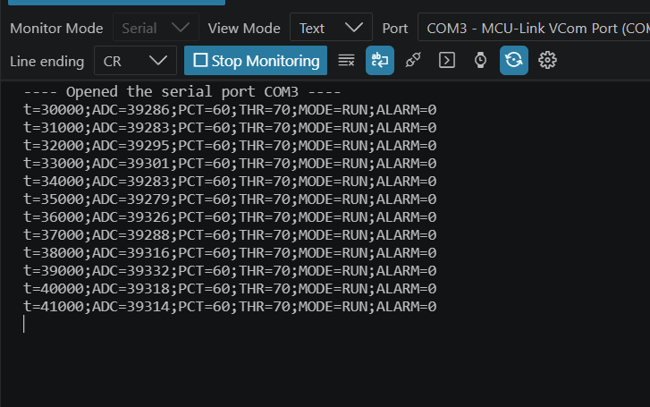
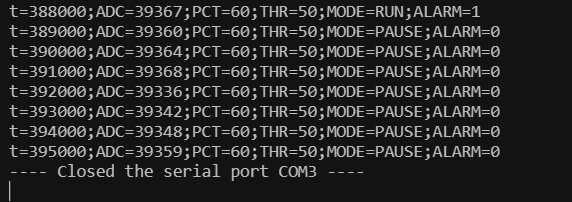
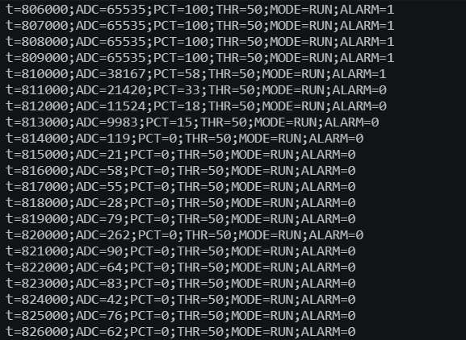

# Monitor analógico con alarma configurable — FRDM-MCXA156

**Institución:** Instituto Tecnológico de Las Américas (ITLA)  
**Asignatura:** Microcontroladores  
**Estudiante:** Thalía Aminisha Pimentel  
**Matrícula:** 2025-0531  
**Repositorio:** `thaliaparcial2micro`  
**Lenguaje:** C  
**Placa:** NXP FRDM-MCXA156  
**Microcontrolador:** NXP MCXA156VLL (Arm Cortex-M33)  
**Pruebas de funcionamiento:** 8 de noviembre de 2026

## 1. Objetivo

Diseñar, implementar y comprobar un monitor de señal analógica basado en la **FRDM-MCXA156** que lea un potenciómetro, convierta la lectura a porcentaje y controle una alarma mediante un LED blanco. El sistema incluye **ADC, GPIO, CTIMER1, UART, modos RUN/PAUSE, pulsador SW2, histéresis y telemetría periódica**.

**Resultado:** el proyecto se compiló, se grabó y se ejecutó físicamente en la placa. En las pruebas se observaron lecturas del ADC, respuesta de ambos LED, estados RUN/PAUSE, comandos UART, histéresis y temporización periódica. Las pruebas realizadas se documentan en [Resultados y evidencias](evidencias/RESULTADOS_P01_P10.md).

## 2. Herramientas y versiones

| Herramienta | Función | Versión identificada en la práctica |
|---|---|---|
| Visual Studio Code | Edición y compilación del proyecto | Utilizado; número de versión no registrado en las capturas |
| Extensión MCUXpresso for VS Code | Integración del SDK, Build, Flash y depuración | Utilizada; número de versión no registrado en las capturas |
| **MCUXpresso SDK** | Controladores de FRDM-MCXA156 | **26.9.0** |
| **Arm GNU Toolchain** | Compilador cruzado para Arm | **14.2.1** |
| **LinkServer** | Programación y depuración por MCU-Link | **26.6.137** |
| GitHub Desktop | Historial de cambios y publicación del código | Utilizado; número de versión no registrado |
| Windows | Sistema operativo del equipo de trabajo | Utilizado; edición no registrada |

Las versiones numéricas indicadas del SDK, compilador y LinkServer fueron visibles en el entorno utilizado al compilar este repositorio. No se asignan versiones sin evidencia.

## 3. Materiales y mapa de pines

El montaje utiliza la placa FRDM-MCXA156, un potenciómetro, dos LED externos (rojo y blanco), dos resistencias limitadoras de **330 Ω**, cables y conexión USB-C mediante MCU-Link. La consigna de materiales solicita potenciómetro de **10 kΩ**; la lectura depende de la proporción de voltaje en el cursor cuando se conecta entre 3.3 V y GND.

| Elemento | Conexión física en la placa | Pin / módulo del MCU | Función |
|---|---|---|---|
| Potenciómetro, terminal central | **A0 / J4-2** | **P1_10 / ADC1_A8** | Entrada ADC |
| Potenciómetro, extremo positivo | **J3-8 / LDO_3V3** | 3.3 V | Alimentación |
| Potenciómetro, extremo negativo | **J3-12 o J3-14** | GND | Tierra común |
| LED rojo externo | **D2 / J1-6** + 330 Ω | **P3_1 / GPIO3[1]** | Indicador de actividad |
| LED blanco externo | **D4 / J1-10** + 330 Ω | **P3_31 / GPIO3[31]** | Indicador de alarma |
| SW2 integrado | Botón WAKE UP | **P1_7 / GPIO1[7]** | RUN/PAUSE; activo en bajo |
| Conexión serial al PC | USB-C **J21 (MCU-Link)** | **LPUART0**, P0_2/P0_3 | Puerto virtual COM |

**D2 y D4 son terminales del conector Arduino**, no los LED integrados de la placa.

### 3.1 Esquema funcional de conexiones

```text
              POTENCIÓMETRO
3.3 V (J3-8) -----[ extremo A ]
                         |
                         o---- cursor central ---- A0 (J4-2 / P1_10)
                         |
GND (J3-12) ------[ extremo B ]

D2 (J1-6 / P3_1) ---[330 Ω]---|>|--- GND    LED ROJO
D4 (J1-10 / P3_31)--[330 Ω]---|>|--- GND    LED BLANCO

SW2 integrado (P1_7, activo en bajo) -------- RUN / PAUSE
PC --- USB-C --- J21 (MCU-Link VCOM) ------- UART LPUART0
```

**Seguridad:** no aplicar 5 V a A0. Compartir GND entre las conexiones, utilizar una resistencia individual por LED y desconectar la alimentación antes de modificar el montaje.

## 4. ADC: VREF, resolución y porcentaje

| Parámetro | Configuración utilizada |
|---|---|
| Periférico | **LPADC1 / ADC1** |
| Entrada | **ADC1_A8**, P1_10, A0 |
| Reloj ADC | **FRO12M / 1 = 12 MHz** |
| Referencia positiva | **VDDA / VREFH**, nominalmente **3.3 V** |
| Referencia negativa | **GND / VREFL** |
| Modo seleccionado en C | `kLPADC_ConversionResolutionHigh` |
| Rango numérico de lectura | **0 a 65535** (resultado de 16 bits) |
| Período de solicitud | **100 ms** |

El firmware selecciona el **modo de alta resolución** del LPADC y maneja un resultado de **16 bits**. Esto describe el formato de conversión programado; no implica una precisión eléctrica efectiva de 16 bits garantizada.

La conversión a porcentaje usa aritmética entera de 32 bits:

```text
PCT = (ADC × 100 + 32767) / 65535
```

Para VREF nominal = 3.3 V, el tamaño numérico ideal de un paso es:

```text
LSB ideal = 3.3 V / 65535 ≈ 0.00005035 V = 50.35 µV
```

En las pruebas se observaron **ADC=65535, PCT=100 %**, lecturas cercanas a cero con **PCT=0 %** y un punto medio de aproximadamente **50 %**. Los códigos pequeños cercanos a cero pueden aparecer como 0 % por el redondeo entero.

## 5. CTIMER1: configuración y cálculo

El temporizador **CTIMER1** genera la base de tiempo que utiliza la aplicación para programar sus tareas sin esperas bloqueantes.

| Parámetro | Configuración en el código |
|---|---|
| Fuente de reloj | `kFRO_HF_to_CTIMER1` |
| Divisor de reloj CTIMER1 | 1 |
| Preescalador (`prescale`) | 0, divisor efectivo 1 |
| Comparador | MATCH0 |
| Reinicio del contador al coincidir | Habilitado |
| Interrupción nominal | Cada **1 ms** |

El programa consulta `CLOCK_GetCTimerClkFreq(1U)` y calcula:

```text
T_tick = 1 ms = 0.001 s
MATCH0 = F_CTIMER / 1000
```

Ejemplo con un reloj efectivo de **96 MHz**:

```text
MATCH0 = 96,000,000 Hz / 1000 = 96,000 cuentas
T_tick = 96,000 / 96,000,000 = 0.001 s = 1 ms
```

La frecuencia de ejemplo no está fijada arbitrariamente en el programa: el valor real se obtiene de la configuración del reloj.

| Tarea | Intervalo programado |
|---|---|
| Inicio de conversión ADC | 100 ms |
| Alternancia del LED rojo | 500 ms |
| Reporte UART | 1000 ms |
| Antirrebote de SW2 | 30 ms de estabilidad |

Durante la ejecución, el **LED rojo parpadeó** y las líneas de telemetría mostraron incrementos de **1000 ms** en el campo `t`. Los tiempos de 100 y 500 ms son valores programados en el firmware; la observación de telemetría no sustituye por sí sola una medición de tolerancia con instrumento.

## 6. UART: configuración y comandos

| Parámetro | Valor |
|---|---|
| Puerto / periférico | **LPUART0** por MCU-Link VCOM |
| Velocidad | **115200 baudios** |
| Datos | **8 bits** |
| Paridad | Ninguna |
| Bits de parada | 1 |
| Control de flujo | Sin control de flujo por hardware |
| Recepción y transmisión | Interrupciones y buffers circulares |
| Terminación de entrada | **LF** o **CRLF** |
| Terminación de respuesta | **CRLF** |
| Puerto observado en la práctica | **COM3** |

| Comando | Respuesta | Comportamiento |
|---|---|---|
| `STATUS` | `t=...;ADC=...;PCT=...;THR=...;MODE=...;ALARM=...` | Reporta el estado |
| `THR 50` | `OK THR=50` | Cambia el umbral a 50 % |
| `START` | `OK RUN` | Reanuda la alarma |
| `STOP` | `OK PAUSE` | Apaga la alarma y mantiene telemetría |
| `THR 96` | `ERR` | Rechaza un umbral inválido |
| `THR 9`, `THR abc`, `THR 50 extra`, `HOLA` | `ERR` | Rechaza entradas no válidas |

El firmware acepta valores decimales de umbral entre **10 % y 95 %**. La telemetría se envía automáticamente cada **1000 ms** y los comandos se procesan sin bloquear el ciclo principal.

## 7. Estados, histéresis y botón SW2

El sistema inicia en **RUN** con `THR=70`. En **PAUSE**, la adquisición ADC y la telemetría continúan, pero el LED blanco se apaga.

La lógica de histéresis es:

```text
Encendido: PCT >= THR
Apagado:   PCT < (THR - 5)
En la banda entre ambos límites: mantener el estado anterior.
```

Con `THR=50`, se comprobó la secuencia: **42 % apagado → 52 % encendido → 47 % encendido → 42 % apagado**.

El pulsador SW2 alternó entre RUN y PAUSE. Al mantenerlo presionado durante aproximadamente dos segundos, el modo permaneció estable sin alternancias adicionales.

## 8. Estructura del código

```text
thaliaparcial2micro/
├── CMakeLists.txt
├── prj.conf
├── .gitignore
├── README.md
├── src/
│   ├── lpadc_polling.c       # main() y control de ADC, TIMER, UART y GPIO
│   ├── alarm_core.h          # Conversión, comandos, estados e histéresis
│   ├── hardware_init.c       # Inicio del hardware
│   ├── pin_mux.c             # Configuración física de pines
│   ├── app.h
│   ├── pin_mux.h
│   ├── adc_control.h
│   ├── led_control.h
│   ├── timer_control.h
│   ├── uart_control.h
│   └── periodic_tasks.h
└── evidencias/
    ├── RESULTADOS_P01_P10.md
    └── capturas/
        ├── uart_monitor_20261108.png
        ├── sw2_pausa_20261108.png
        └── adc_recorrido_20261108.png
```

**Archivos realmente integrados en CMake:** `src/lpadc_polling.c`, `src/hardware_init.c` y `src/pin_mux.c`, junto con los encabezados `app.h`, `pin_mux.h` y `alarm_core.h`. Los otros archivos `.h` documentan módulos auxiliares preparados durante el desarrollo; la aplicación principal utiliza su propia implementación de los periféricos.

## 9. Compilación, grabación y ejecución

1. Abrir la carpeta raíz `thaliaparcial2micro` en **Visual Studio Code** y abrir la extensión **MCUXpresso for VS Code**.
2. Asociar el proyecto con el **MCUXpresso SDK 26.9.0** y la placa **FRDM-MCXA156**, utilizando **Arm GNU Toolchain 14.2.1**.
3. Verificar en `CMakeLists.txt`: `set(board frdmmcxa156)`, `set(board_root examples/_boards)` y `src/lpadc_polling.c` dentro de `mcux_add_source`.
4. En el panel **Projects**, seleccionar la configuración **Debug** y ejecutar **Build Project**.
5. Conectar la placa por USB-C al puerto **MCU-Link J21**. Usar **Debug/Flash** para grabar el firmware. Si se detiene en `main()`, seleccionar **Continue/Resume**.
6. Abrir el monitor serie en **COM3**, o en el puerto MCU-Link VCOM asignado por Windows, con **115200, 8N1**, terminación de comando **LF o CRLF**.
7. Verificar telemetría, lectura del potenciómetro, LED rojo y blanco, `THR 50`, `STOP`, `START` y SW2.

**Resultado de la práctica:** se completaron la compilación, la ejecución física y las comprobaciones funcionales descritas. Los resultados corresponden al código de este repositorio. Los archivos generados en `debug/` no se incluyen en Git gracias a `.gitignore`.

## 10. Resultados y evidencias

El **8 de noviembre de 2026** se documentaron las pruebas funcionales del proyecto en la FRDM-MCXA156 con el monitor UART y observaciones en la placa. El detalle y las capturas están organizados en:

**[Ver resultados y evidencias del proyecto](evidencias/RESULTADOS_P01_P10.md)**

<details>
<summary>Capturas de la práctica</summary>

**Monitor UART y telemetría**



**Modo PAUSE y pulsador SW2**



**Recorrido ADC del potenciómetro**



</details>

## 11. Referencias técnicas

- [NXP — Manual de usuario FRDM-MCXA156 (UM12121)](https://www.nxp.com/docs/en/user-manual/UM12121.pdf)
- [NXP — Guía de inicio para FRDM-MCXA156](https://www.nxp.com/document/guide/getting-started-with-frdm-mcxa156:GS-FRDM-MCXA156)
- [NXP — API de MCXA156](https://mcuxpresso.nxp.com/mcuxsdk/latest/api/devices/MCXA156/index.html)
