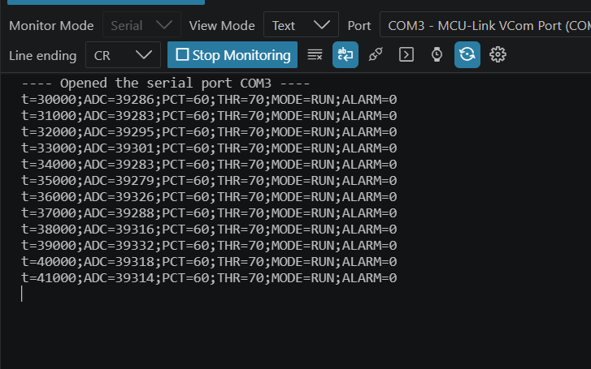
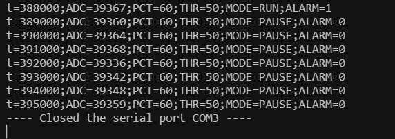
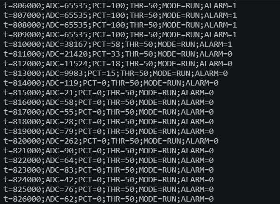

# Resultados y evidencias — FRDM-MCXA156

**Proyecto:** `thaliaparcial2micro`  
**Estudiante:** Thalía Aminisha Pimentel — 2025-0531  
**Fecha de ejecución:** 8 de noviembre de 2026  
**Hardware:** NXP FRDM-MCXA156, potenciómetro, LED rojo y LED blanco externos, SW2 integrado  
**Entorno:** MCUXpresso SDK 26.9.0, Arm GNU Toolchain 14.2.1, LinkServer 26.6.137; puerto serial COM3 a 115200 baudios.

## 1. Ejecución del firmware

Se compiló el proyecto `thaliaparcial2micro` desde Visual Studio Code con la extensión MCUXpresso y se grabó en la placa mediante MCU-Link. Durante la ejecución se observó la comunicación UART, la respuesta del potenciómetro y el control de ambos LED y del pulsador SW2.

## 2. Comprobaciones realizadas

| Área | Procedimiento efectuado | Resultado observado |
|---|---|---|
| **Compilación y ejecución** | Compilar, grabar y abrir monitor serial | Firmware ejecutándose; COM3 recibió telemetría |
| **Estado de operación** | Observar arranque y lectura UART | `THR=70;MODE=RUN;ALARM=0` con `PCT=60` |
| **ADC** | Recorrer extremos y mitad del potenciómetro | `PCT` cercano a 0 %, 50 % y 100 % |
| **LED rojo y CTIMER** | Observar LED y reporte periódico | Parpadeo continuo; incremento de 1000 ms en `t` |
| **Umbral y LED blanco** | Enviar `THR 50` con PCT ≈ 60 % | `OK THR=50`, LED blanco encendido |
| **STOP** | Enviar `STOP` | `OK PAUSE`, LED blanco apagado; telemetría activa |
| **START** | Enviar `START` | `OK RUN`, LED blanco encendido con PCT > THR |
| **SW2** | Presionar dos veces | Alternancia RUN → PAUSE → RUN |
| **Antirrebote** | Mantener SW2 presionado ≈2 s | Sin alternancias repetidas mientras permaneció presionado |
| **Histéresis** | Ajustar PCT a 42 %, 52 %, 47 %, 42 % con THR=50 | LED blanco: apagado → encendido → encendido → apagado |
| **Comandos incorrectos** | Enviar `THR 96`, `THR 9`, `THR abc`, `THR 50 extra` y `HOLA` | Respuesta `ERR`; umbral conservado en 50 % |

Estos resultados registran pruebas funcionales realizadas en la placa. Los intervalos programados y la resolución numérica se describen en el README y en el código fuente; las capturas no equivalen a mediciones instrumentales de precisión.

## 3. Fragmentos de telemetría registrados

### 3.1 Activación y pausa

```text
t=388000;ADC=39367;PCT=60;THR=50;MODE=RUN;ALARM=1
t=389000;ADC=39360;PCT=60;THR=50;MODE=PAUSE;ALARM=0
t=390000;ADC=39364;PCT=60;THR=50;MODE=PAUSE;ALARM=0
t=391000;ADC=39368;PCT=60;THR=50;MODE=PAUSE;ALARM=0
t=392000;ADC=39336;PCT=60;THR=50;MODE=PAUSE;ALARM=0
```

En esta secuencia se mantiene `PCT=60` aproximadamente mientras el sistema pasa de RUN a PAUSE; `ALARM` cambia de 1 a 0 y la telemetría continúa.

### 3.2 Recorrido del ADC

```text
t=806000;ADC=65535;PCT=100;THR=50;MODE=RUN;ALARM=1
t=807000;ADC=65535;PCT=100;THR=50;MODE=RUN;ALARM=1
t=809000;ADC=65535;PCT=100;THR=50;MODE=RUN;ALARM=1
t=810000;ADC=38167;PCT=58;THR=50;MODE=RUN;ALARM=1
t=811000;ADC=21420;PCT=33;THR=50;MODE=RUN;ALARM=0
t=812000;ADC=11524;PCT=18;THR=50;MODE=RUN;ALARM=0
t=814000;ADC=119;PCT=0;THR=50;MODE=RUN;ALARM=0
t=815000;ADC=21;PCT=0;THR=50;MODE=RUN;ALARM=0
```

La lectura recorrió prácticamente todo el rango numérico. Las variaciones de códigos pequeños cerca de cero se redondean a `PCT=0`.

## 4. Capturas del proyecto

### 4.1 Monitor serial UART



Archivo: `capturas/uart_monitor_20261108.png`

### 4.2 Pulsador SW2 y modo PAUSE



Archivo: `capturas/sw2_pausa_20261108.png`

### 4.3 Recorrido del potenciómetro



Archivo: `capturas/adc_recorrido_20261108.png`

## 5. Conclusión

Se consiguió la integración funcional de **GPIO, ADC1, CTIMER1 y LPUART0** en un mismo firmware en lenguaje C para la FRDM-MCXA156. La compilación y la ejecución física permitieron comprobar la lectura del potenciómetro, el cambio de umbral, el apagado y reanudación de la alarma, la alternancia mediante SW2, el comportamiento de histéresis y la transmisión de telemetría UART. Las capturas y los valores mostrados pertenecen a las pruebas de este repositorio.

**Alcance de los resultados:** se reportan únicamente las operaciones verificadas durante esta sesión; no se añaden métricas ni ensayos de precisión que no estén respaldados por una medición presentada.
